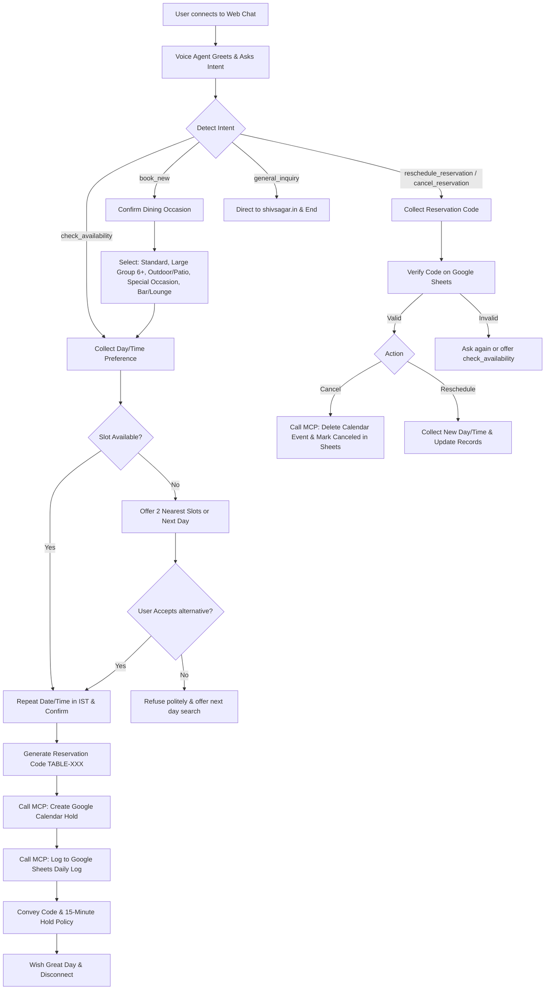

# Product Requirement Document (PRD)
## Voice-Enabled Restaurant Table Reservation Assistant & Web Host

---

### 1. Executive Summary & Product Vision

In the fast-paced restaurant industry, missing a phone call often means losing a customer. Hosts and restaurant managers are constantly juggling physical guests, kitchen logistics, and ringing telephones. The **Restaurant Table Reservation Assistant** is an autonomous, voice-first AI agent hosted on a web application. It enables diners to effortlessly reserve, reschedule, or cancel table bookings in real-time, operating 24/7 with zero human intervention.

Integrating seamlessly with back-end restaurant management tools via the **Model Context Protocol (MCP)**, the assistant makes tentative holds on Google Calendar and logs reservation details in Google Sheets. It respects strict privacy constraints (no PII requested) and ensures absolute operational clarity by repeating reservation details in Indian Standard Time (IST).

---

### 2. The Market Opportunity: Why This Product Will Work

Voice remains the most natural and immediate medium for restaurant bookings. However, existing booking channels present major friction points:

*   **Online Web Portals (OpenTable, Resy)**: Require users to download an app or navigate complex forms, sign in, and share personal data. 
*   **Traditional IVR (Interactive Voice Response)**: "Press 1 for reservations..." leads to customer frustration and high drop-off rates due to rigid, robotic menus.
*   **Manual Call Handling**: Host staffs are frequently too busy during peak hours to answer calls. Industry surveys indicate up to **30% of reservation inquiries** go unanswered during peak weekend rushes.

#### Market Alternatives & Competitive Positioning

| Alternative | Customer Effort | Cost to Restaurant | Conversational Experience | Dynamic Availability Handling |
| :--- | :--- | :--- | :--- | :--- |
| **Manual Host Phone Calls** | High (hold times, busy signals) | High (staff hours, missed calls) | Natural, but inconsistent | Good, but slow and error-prone |
| **Aggregators (OpenTable/Resy)** | Medium (forms, sign-up required) | High ($1-$2.50 per cover + monthly fees) | Non-existent (UI-based) | Rigid calendar-only slots |
| **Traditional Dialer IVR** | Very High (menu-driven) | Low-Medium (legacy setup) | Frustrating, robotic | Extremely poor (cannot negotiate slots) |
| **Antigravity Voice Agent** | **Low (natural spoken speech)** | **Very Low (pay-per-use API cost)** | **Natural, human-like (real-time)** | **Excellent (dynamic slot offers & overrides)** |

#### Business Value Proposition
1. **Zero Missed Revenue**: Answers 100% of calls instantly, even during Friday night peak rushes.
2. **Staff Optimization**: Frees the host staff to focus on in-person guest experience and table turnover.
3. **Disintermediation**: Bypasses aggregator booking commissions, saving restaurants thousands of dollars in cover fees.
4. **Error Reduction**: Automated writing to Google Sheets/Google Calendar via MCP removes human typos, double-bookings, and spelling errors.

---

### 3. User Pain Points & Customer Anecdotes

#### Diner Pain Point: The Busy Commuter & spelling names
> **Anecdote (Rahul, 34, Consultant):**
> *"I was driving home on Friday night and wanted to grab a table for my wedding anniversary at a popular local spot. I tried calling them twice, but it kept ringing out. When they finally picked up, the restaurant was so noisy that the host couldn't hear me properly. They spent 3 minutes trying to spell my name and phone number. By the time it was done, I was stressed, and they still got my reservation time wrong by half an hour. I wish I could have just told an AI what I wanted, got a quick code, and hung up."*

#### Restaurant Manager Pain Point: The Peak-Hour Chaos
> **Anecdote (Priya, 42, Manager at Shiv Sagar):**
> *"During our weekend rush between 7:30 PM and 9:30 PM, the phone rings every 2 minutes. My host is trying to seat walk-ins, print bills, and guide servers. They either have to ignore the ringing phone—which means losing customers—or answer it and make the guests waiting in front of them feel ignored. Plus, when the host is writing down bookings in a rush, the handwriting is messy, and they often forget to check if patio seating is actually full, leading to double-booked tables and angry walk-ins."*

---

### 4. Goals & Success Metrics

#### Business Goals
*   **Maximize Booking Efficiency**: Deflect 80%+ of booking calls away from manual host intervention.
*   **Zero Double-Bookings**: Maintain 100% synchronization accuracy between the AI agent and the restaurant's live sheets/calendars.
*   **Customer Retention**: Provide a fast booking loop (under 90 seconds) to prevent caller abandonment.

#### Product Success Metrics
*   **Booking Completion Rate (BCR)**: Percentage of calls initiated with a booking intent that result in a generated reservation code (Target: >85%).
*   **Deflection Rate**: Percentage of calls handled successfully without escalation or referral to manual restaurant phone lines (Target: >90%).
*   **Average Handling Time (AHT)**: Time taken to finalize a booking (Target: <75 seconds for Phase 1, <45 seconds for Phase 2).
*   **User Satisfaction Rating (CSAT)**: Post-call quick feedback option (Target: >4.5/5).

#### Engineering Performance Metrics
*   **Turn-around Latency**:
    *   **Phase 1 (Push-to-Speak)**: Under 1.8 seconds total processing time (STT + LLM + TTS + network overhead).
    *   **Phase 2 (Streaming)**: Under 800ms response latency from user silence detection to audio streaming start.
*   **Word Error Rate (STT Accuracy)**: Under 5% in typical noisy restaurant conditions.
*   **MCP Sync Success Rate**: 99.9% success rate for calendar hold creation and sheets log writing.

---

### 5. Functional Requirements: Features to Build

#### 5.1 System Intent Mapping
The voice agent must support **5 core intents**:

1.  `book_new`: Initiates a new table reservation flow.
2.  `reschedule_reservation`: Edits the date, time, or occasion of an existing reservation using the reservation code.
3.  `cancel_reservation`: Cancels a reservation and frees up the slot on Google Calendar/Sheets using the reservation code.
4.  `check_availability`: Queries the restaurant inventory for a specific date and time without committing to a booking.
5.  `general_inquiry`: Handles non-transactional questions (e.g., menu, hours, directions) by redirecting users to [shivsagar.in](https://shivsagar.in).

#### 5.2 Conversational Flow Logic



#### 5.3 Step-by-Step Conversation Flow Details

1.  **Greeting**: Welcomes the user: *"Hello! Welcome to Shiv Sagar's automated booking assistant. How can I help you today? You can book a table, reschedule, or cancel a reservation."*
2.  **Dining Occasion Collection**: Must prompt the user to choose one of:
    *   *Standard Dining*
    *   *Large Group (6+ people)*
    *   *Outdoor/Patio*
    *   *Special Occasion/Anniversary*
    *   *Bar/Lounge*
3.  **Day & Time Preference Collection**: Collects the target date (e.g., "this Friday", "August 8th") and time (e.g., "7:30 PM").
4.  **Inventory Check**: Checks the mock inventory database.
    *   *If exact slot is free*: Proceeds to confirmation.
    *   *If slot is busy*: Suggests two nearest available slots on the same day (e.g., requested 7:30 PM; offers 7:00 PM and 8:15 PM) or states that the day is full and asks to look at another day.
5.  **Reservation Code Generation**: Once the user selects and confirms a slot, the system generates a code with format `TABLE-[Letter][Digit][Digit]` (e.g., `TABLE-B99`).
6.  **MCP Execution (Double Write)**:
    *   **Google Calendar**: Create a tentative calendar event titled `Dining Hold — {Occasion} — {Code}` for the target slot.
    *   **Google Sheets**: Append a row to the spreadsheet "Daily Reservation Log" with `[Date, Occasion, Slot, Code]`.
7.  **Final Confirmation**: The agent states: *"Got it! I have reserved that table for you on [Date] at [Time] Indian Standard Time (IST). Your unique reservation code is [Code]. Please present this code when you arrive. Please note we will hold your table for a maximum of 15 minutes past your reservation time. Have a wonderful day!"*

---

### 6. Key Constraints & Business Rules

*   **Privacy First (Strict No-PII Policy)**: The assistant **must not** ask for, record, or store the diner's phone number, email address, full name, or credit card details. The transaction is completely authorized and tracked via the generated `Reservation Code`.
*   **Time Zone Clarity**: To prevent reservation errors, the agent must explicitly use **Indian Standard Time (IST)** in all confirmations (e.g., *"Your booking is confirmed for 8:00 PM Indian Standard Time"*).
*   **Allergy and Medical Refusals**: If a customer asks medical or safety-related questions about food prep (e.g., *"Is your kitchen 100% free of trace gluten for a severe celiac allergy?"*), the agent must decline to answer directly:
    *   *Refusal Response:* *"For safety reasons, I cannot give medical or ingredient safety advice. Please contact the restaurant staff directly or visit shivsagar.in to review our kitchen protocols."*
*   **FAQ / Timings Redirection**: For questions regarding the physical menu, current restaurant opening/closing hours, or parking details, the agent must say:
    *   *Redirection Response:* *"You can find our latest menu and timings on our website at shivsagar.in. Is there anything else I can help you with regarding your booking?"*
*   **Audio Interruption Handling**: The voice agent must immediately cease speaking (stop audio playback) the millisecond user speech is detected, ensuring a natural cadence where the diner can speak over the AI.
*   **Background Noise Filtering**: The application front-end must implement noise gate/suppression algorithms, and the STT configuration must prioritize clean speech transcription to handle busy streets, home noise, or car commutes.

---

### 7. Implementation Phases

We will build the application in two distinct phases to ensure stability, validate the conversational flow, and then optimize for a high-fidelity streaming experience.

```
┌────────────────────────────────────────────────────────────────────────┐
│                               PHASE 1                                  │
│  - Push-to-Speak Conversational Flow                                    │
│  - Deepgram (STT) + Groq Llama 3.3 (LLM) + Smallest AI (TTS)           │
│  - Turn-based Audio processing over HTTP/REST API                       │
└──────────────────────────────────┬─────────────────────────────────────┘
                                   │
                                   ▼
┌────────────────────────────────────────────────────────────────────────┐
│                               PHASE 2                                  │
│  - Real-Time Full-Duplex Audio Streaming                                │
│  - Gemini Live API (WebSockets)                                        │
│  - Continuous Listening, Native Interruptions, & Low Latency (<800ms)   │
└────────────────────────────────────────────────────────────────────────┘
```

#### Phase 1: Push-to-Speak Conversational System (Turn-Based)

*   **User Interface**: A chat screen with a large microphone button.
*   **Interaction Model**:
    1.  User clicks and holds (or clicks once to start recording) the microphone.
    2.  User speaks their query and clicks "Stop/Send".
    3.  Audio payload is sent to the backend.
    4.  **STT (Deepgram)**: Transcribes user audio to text.
    5.  **LLM (Groq Llama 3.3 Versatile)**: Processes transcription, checks state/intent, executes MCP tools if needed, and formulates a text response.
    6.  **TTS (Smallest AI Waves)**: Synthesizes LLM response text to high-quality audio.
    7.  Web client receives text and audio, updates the chat bubbles, and plays the audio response.
*   **Pros**: Highly reliable, easy to debug, low resource cost, high LLM reasoning power with Llama 3.3.
*   **Cons**: Higher latency (sequential API hops); requires explicit user clicks (not fully hands-free).

#### Phase 2: Live Streaming Voice Agent (Continuous Conversation)

*   **User Interface**: An active visualizer displaying audio frequency waves, with a simple toggle to "Mute" or "Disconnect" the call.
*   **Interaction Model**:
    1.  User clicks "Start Call". The browser requests microphone permission and establishes a persistent WebSocket connection.
    2.  **Streaming Engine (Gemini Live API)**: The web browser streams raw audio input directly to the Gemini Live API via WebSockets.
    3.  Gemini Live handles STT, LLM generation, and TTS synthesis in a unified pipeline, streaming back audio chunks.
    4.  **Interruption Detection**: If the user starts talking while the agent is speaking, the Gemini Live API detects the incoming voice stream, immediately stops transmitting the current audio response, and switches to listening.
    5.  **MCP Integration**: The Gemini Live session dynamically calls custom tools (Google Sheets/Calendar) in the middle of the streaming turn.
*   **Pros**: Ultra-low latency (<800ms), natural conversation flow, hands-free operation, native interruption handling.
*   **Cons**: Requires WebSockets, higher bandwidth requirements, demands robust noise-filtering on client side to avoid false interruption triggers.

---

### 8. Tech Stack Architecture

The unified web application will use the following technology stack:

*   **Frontend**: 
    *   HTML5, Vanilla CSS (Premium glassmorphism UI, custom CSS variables, responsive design).
    *   Web Audio API for microphone capture, audio playback, and visualizer rendering.
    *   WebSocket client for Phase 2 integration.
*   **Backend Server**:
    *   Node.js (Express) or Python (FastAPI) to proxy requests, securely manage API keys, and host the MCP servers.
*   **Model Context Protocol (MCP) Integration**:
    *   **Google Calendar MCP Server**: Connects to the restaurant's Google Calendar to query availability, block out slots (`Dining Hold`), and remove holds upon cancellation.
    *   **Google Sheets MCP Server**: Appends reservation records (`Daily Reservation Log`) and validates Reservation Codes.
*   **AI Service Integration**:

| Component | Phase 1 (Push-to-Speak) | Phase 2 (Live Streaming) |
| :--- | :--- | :--- |
| **Speech-to-Text (STT)** | **Deepgram** (Nova-2 model for fast, accurate transcriptions) | **Gemini Live API** (Built-in multimodal audio input processing) |
| **Orchestration / LLM** | **Groq API** (Llama 3.3 Versatile, selected for its speed and system prompt adherence) | **Gemini 2.0 Flash / Live** (Multimodal LLM running tool-use loops) |
| **Text-to-Speech (TTS)** | **Smallest AI** (Waves API for hyper-realistic voice generation under 150ms synthesis time) | **Gemini Live API** (Built-in real-time audio output streaming) |

---

### 9. Edge Cases & Exception Handling

| Edge Case | Scenario | System Behavior / Mitigation |
| :--- | :--- | :--- |
| **Slot Overlap / Busy Inventory** | Diner asks for Friday at 8:00 PM, but all tables are booked. | Agent checks inventory and offers: *"I'm sorry, Friday at 8:00 PM is fully booked. I can offer you 7:15 PM or 9:00 PM instead, or we can look at Thursday or Saturday. Would any of those work?"* |
| **Noisy Background** | User is walking on a busy street or driving with window down. | **Phase 1**: Frontend uses Web Audio API high-pass filters and noise-gate compression before sending to Deepgram.<br>**Phase 2**: Use client-side echo cancellation and noise suppression options (`echoCancellation: true, noiseSuppression: true`) inside `getUserMedia()`. |
| **User Interruption** | Agent is speaking confirmation details, user interrupts: *"Oh wait! Make that standard dining instead of patio."* | **Phase 1**: User hits mic button, resetting the state. Agent processes the new input.<br>**Phase 2**: Gemini Live immediately halts audio output stream, processes incoming text, modifies the occasion parameters, and speaks back the updated state. |
| **PII Input Leak** | Diner proactively says: *"My name is Rahul, my phone is 9988776655, please book it."* | The agent filters out any names or phone numbers, and proceeds with code-only booking without writing name/phone to Google Sheets/Calendar. |
| **Medical / Allergy Questions** | Diner asks: *"Is your pesto completely safe for a child with a severe tree nut allergy?"* | Agent executes strict refusal rule: *"For safety reasons, I cannot provide allergy or medical guarantees. Please check our site shivsagar.in or call our kitchen directly at our physical number for allergy compliance."* |
| **Reschedule Code Not Found** | Diner provides code `TABLE-Z99` to reschedule, but it doesn't exist in the Sheets log. | Agent says: *"I couldn't find a booking under the code TABLE-Z99. Could you please double-check your code? Or, if you'd like, I can create a new booking for you."* |
| **MCP API Offline** | Google Sheets/Calendar API is down or rate-limited during a booking. | The agent saves the reservation to local backup cache and conveys confirmation to user. A background cron worker retries the Google Sheets/Calendar sync once the APIs recover. |

---

### 10. Go-To-Market (GTM) Plan & Rollout Strategy

#### Phase 1: Alpha Pilot (Weeks 1 - 4)
*   **Target**: Single pilot restaurant (e.g., Shiv Sagar's flagship location).
*   **Integration**: Add the chat widget to a hidden staging page on `shivsagar.in` for staff testing.
*   **Method**: Restaurant staff uses the push-to-speak interface to log phone bookings themselves to test integration stability with Google Calendar and Sheets.

#### Phase 2: Beta Launch (Weeks 5 - 8)
*   **Target**: 100 friendly local diners.
*   **Integration**: Deploy the Phase 1 Push-to-Speak widget publicly on the homepage of `shivsagar.in` with a banner: *"Try our new voice booking assistant!"*
*   **Feedback Loops**: Capture success rates and trigger customer surveys via SMS right after the reservation code is generated.

#### Phase 3: Streaming Launch & Scale (Weeks 9+)
*   **Target**: Deploy Phase 2 (Streaming Gemini Live API) for general public usage.
*   **Marketing Hooks**:
    *   **"Book in a single breath"**: Run social media videos showing a user reserving a table while driving or carrying groceries hands-free in under 30 seconds.
    *   **B2B Campaign**: Showcase metrics to other franchise owners displaying how the agent deflected 90% of bookings, saved 40 hours of front-of-house staff time per month, and zeroed out double-bookings.

---

### 11. Security & Compliance

*   **GDPR & Data Protection**: Since the voice assistant adheres to a strict "No-PII" policy, the application does not store customer names, phone numbers, or email addresses. This keeps the restaurant entirely out of scope for complex privacy compliance audits regarding reservation data storage.
*   **Encryption**: All voice streams (WebSocket) and REST requests are encrypted in transit via TLS 1.3/HTTPS.
*   **Secure API Handling**: All keys for Deepgram, Groq, Smallest AI, Gemini Live, and Google Workspace are stored in server-side environment variables and are never exposed to the client browser.
