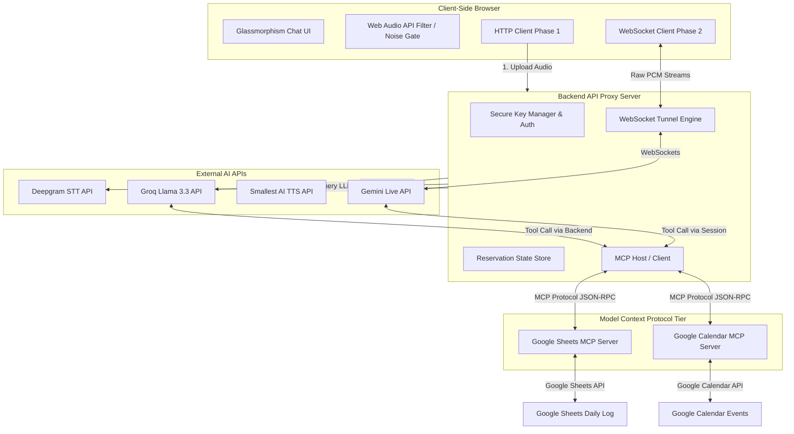
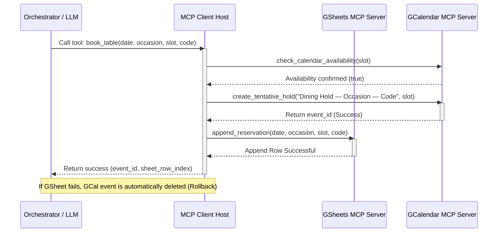
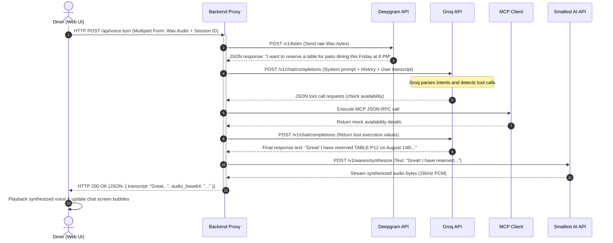

# System Architecture Document (architecture.md)
## Restaurant Voice Reservation Assistant (Shiv Sagar Web App)

This document describes the end-to-end technical architecture, component interfaces, data flows, and protocol details for hosting the Voice Table Reservation Assistant.

---

### 1. High-Level Component Architecture

The system is split into three main layers: **Client Web Application**, **Secure Backend Server**, and the **Third-Party AI & Integration Tier** connected via standard REST protocols, WebSockets, and the **Model Context Protocol (MCP)**.



---

### 2. Frontend System Components

#### 2.1 Audio Processing Pipeline (Web Audio API)
To ensure reliable transcription in noisy environments (such as cars, streets, or bustling offices), the browser's input microphone track is piped through an audio nodes graph before transmission:

1.  **MediaStreamSourceNode**: Captures the raw audio from `navigator.mediaDevices.getUserMedia({ audio: { echoCancellation: true, noiseSuppression: true } })`.
2.  **BiquadFilterNode (High-Pass)**: Configured with a cutoff frequency of `120Hz` to eliminate low-frequency environment rumbles, engine hums, and structural vibration.
3.  **DynamicsCompressorNode (Noise Gate)**: Acts as a dynamic gate. Sets a threshold at `-45dB` to suppress background noise when the user is not actively speaking.
4.  **AudioWorkletNode / ScriptProcessorNode**:
    *   *Phase 1*: Accumulates recorded blocks into a `16-bit Mono Linear PCM Wav` buffer at `16kHz`.
    *   *Phase 2*: Streams raw audio chunks (`pcm16` encoding, `16kHz` sample rate, mono) dynamically over the established WebSocket channel.

#### 2.2 Dynamic Canvas Wave Visualizer
A high-performance visualizer renders real-time audio amplitudes:
*   An `AnalyserNode` extracts real-time fast Fourier transform (FFT) time-domain data.
*   A `RequestAnimationFrame` render loop calculates Bezier curves on an HTML5 `<canvas>` element.
*   Visual modes alter based on socket state:
    *   *Idle*: Slow-moving breathing marigold waves.
    *   *Listening (User Speaking)*: Responsive green/teal wave heights linked to user voice intensity.
    *   *Speaking (Agent Transmitting)*: Fluid gold/saffron ripples controlled by incoming speaker volume nodes.

---

### 3. Backend Proxy Server

The server (built using Node.js/Express or Python/FastAPI) functions as a secure gateway:
1.  **API Secret Shielding**: Third-party API keys (Deepgram, Groq, Smallest AI, Gemini Live) are securely stored in server environment variables (`.env`) and never exposed to the client browser.
2.  **Phase 1 Orchestration Endpoint**: Receives user wav payloads, runs the sequential pipeline (STT $\rightarrow$ LLM $\rightarrow$ TTS), executes local database inventory operations, and returns combined transcript text and base64-encoded audio.
3.  **Phase 2 WebSocket Tunneling**: Acts as a stateful TCP proxy between the client browser socket and the external Gemini Live WebSocket server (`wss://api.gemini.ai/v1/live`). The backend injects the authorization header containing the API key dynamically during setup.

---

### 4. Model Context Protocol (MCP) Integration

The assistant uses the standardized Model Context Protocol (JSON-RPC 2.0 over standard I/O transport) to interface with reservation storage.

#### 4.1 Schema Definitions

##### Google Sheets MCP Server
Exposes tools to write, query, and invalidate table allocations:
*   `read_reservation_log(date: string)`: Queries the "Daily Reservation Log" spreadsheet for a specific date to verify code allocations.
*   `append_reservation(date: string, occasion: string, slot: string, code: string)`: Writes a new confirmed row to the spreadsheet.
*   `update_reservation_status(code: string, new_date?: string, new_slot?: string, status: "ACTIVE" | "CANCELED")`: Modifies existing rows.

##### Google Calendar MCP Server
Exposes tools to register holds on visual schedules:
*   `check_calendar_availability(start_time: string, end_time: string)`: Queries the targets to check for conflicts.
*   `create_tentative_hold(summary: string, start_time: string, end_time: string)`: Creates a Calendar Event with the title `Dining Hold — {Occasion} — {Code}`.
*   `cancel_tentative_hold(event_id: string)`: Deletes or releases calendar events on cancel/reschedule.

#### 4.2 Double-Write Safety Protocol
To prevent synchronization mismatch (where a booking is logged in Sheets but fails to populate Google Calendar, or vice-versa), the tool caller executes a strict transaction flow:



---

### 5. Detailed Conversational Pipelines

#### 5.1 Phase 1 Sequence Flow (Push-to-Speak HTTP Loop)

This sequence runs on discrete, turn-based REST requests.



#### 5.2 Phase 2 Sequence Flow (Streaming WebSocket Loop)

This sequence uses persistent connections for zero-latency, full-duplex conversations.

```mermaid
sequenceDiagram
    autonumber
    actor User as Diner (Web UI)
    participant Proxy as Backend WebSocket Proxy
    participant Gemini as Gemini Live WebSocket API
    participant MCP as MCP Client

    User->>Proxy: Establish WebSocket Client Connection
    Proxy->>Gemini: Connect wss://api.gemini.ai/v1/live (Injects API key headers)
    Note over User,Gemini: Full-duplex connection initialized
    
    loop Stream Voice Loops
        User->>Proxy: Stream raw binary PCM input packets (user talking)
        Proxy->>Gemini: Forward PCM audio packets directly
        Gemini->>Gemini: Process audio, evaluate intents in real-time
    end

    Note over User,Gemini: User stops talking; Gemini Live synthesizes voice response
    
    loop Stream Agent Voice
        Gemini->>Proxy: Stream synthesized audio output frames
        Proxy->>User: Forward audio frames immediately
        User->>User: Play audio dynamically via Web Audio API Queue
    end

    Note over User,Gemini: User interrupts agent by speaking mid-sentence

    User->>Proxy: Stream new user audio frames
    Proxy->>Gemini: Forward incoming audio packets
    Gemini->>Gemini: Detect user speech interruption
    Gemini->>Proxy: Transmit cancellation command control frame (cancel_current_audio)
    Proxy->>User: Forward cancellation command
    User->>User: Instantly flush/empty Web Audio playback queue (agent stops speaking)
```

---

### 6. Fail-Safe Operations & Resiliency

*   **Offline Booking Queue**: If Google Sheets or Google Calendar APIs return 5xx errors (system offline or Google rate-limits hit), the backend logs the booking details to a persistent local SQLite queue with status `PENDING_SYNC`. A background Cron task runs every 60 seconds to retry sync once services restore.
*   **Fallback Voice Mode**: If Phase 2 WebSocket connection fails due to network bandwidth constraints on the user’s mobile browser, the client interface automatically drops back to Phase 1 (Push-to-Speak turn-based system) and alerts the user: *"Network speed is low. Switching to push-to-talk mode."*
*   **Session Expiry/Timeout**: Reservation codes are held tentatively for 15 minutes. A server-side scheduler registers a webhook. If no final confirmation is logged on Sheets within 15 minutes, the event is deleted from Google Calendar to free up table inventory.
*   **PII Stripping Filters**: The backend runs a regular expression scanner on the transcribed text from STT. Any sequence resembling telephone numbers, email structures, or full credit card hashes are stripped out and replaced with `[MASKED]` tags before being processed by the LLM, protecting user privacy.
